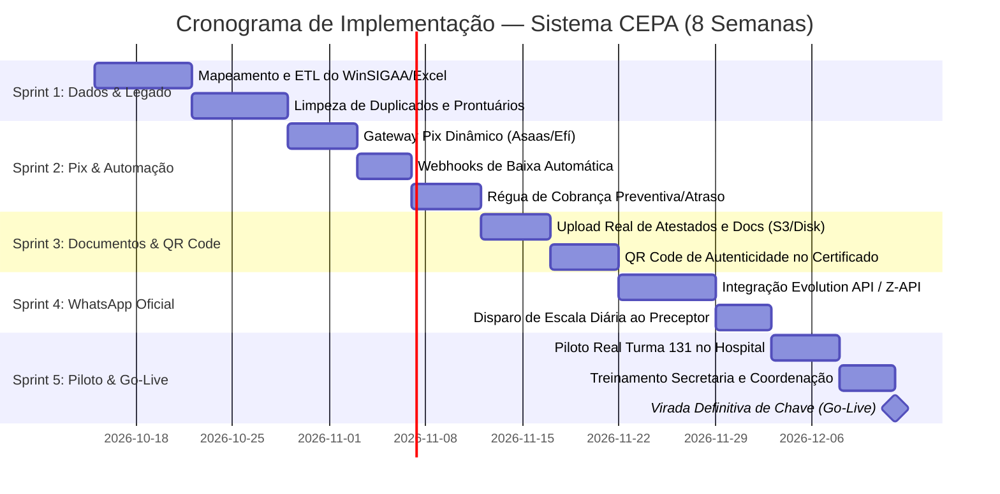

# 📋 Plano Diretor & Cronograma de Implantação Definitiva — Sistema CEPA / CFIC

---

## 🎯 Objetivo Executivo

Elevar o **Sistema Integrado de Gestão CEPA / CFIC** do estágio atual de homologação arquitetural para a **operação oficial em produção**, garantindo:
1. **Migração completa e higienizada** de dados do legado (WinSIGAA e planilhas históricas de chamadas/crachás).
2. **Automação financeira** de ponta a ponta (Pix Dinâmico com baixa instantânea via Webhook e régua de cobrança automática via API WhatsApp).
3. **Validação pública e QR Code** nos certificados oficiais (padrão CFIC e GDAE).
4. **Homologação piloto em campo hospitalar** com a Turma 131 e transição assistida para toda a escola.

---

## 📅 Cronograma Executivo de 8 Semanas (Roadmap até o Go-Live)

---

## 🧩 Detalhamento dos Módulos e Entregáveis por Sprint

### 📌 Sprint 1 (Semanas 1 e 2): Migração de Dados Históricos & Carga Real
> **Meta:** Alimentar o banco de dados oficial com todo o histórico de alunos ativos, desistentes e turmas anteriores.

* **Atividade 1.1 — Extração do Legado (WinSIGAA / Quality):**
  - Solicitação da base em formato relacional (PostgreSQL/SQL dump ou CSV estruturado).
  - Mapeamento das tabelas de alunos, mensalidades, parcelas e notas.
* **Atividade 1.2 — Ingestão das Planilhas Locais do CEPA:**
  - Varredura e carga automatizada das planilhas existentes em `C:\Users\MICRO\Desktop\CEPA\`:
    - Chamadas de Outubro (`CHAMADAS_OUTUBRO.xlsx`)
    - Turmas ativas de enfermagem (`AUX-242`, `TN-240`, `ENF_TRAB-39`, `Turma 129`, `Turma 131`)
    - Dados de crachás (`EXCEL - 129.xlsx`, `EXCEL-234.xlsx`, `EXCEL-238.xlsx`)
* **Atividade 1.3 — Script de Higienização (ETL em Node.js):**
  - Criação de `database/scripts/importLegacyData.js`.
  - Tratamento de nomes truncados, validação de CPFs e unificação sob a nova convenção de **Prontuário Sequencial** (`2026-00...`).
  - Classificação retroativa dos motivos de saída de alunos desistentes e trancados.

---

### 📌 Sprint 2 (Semana 3): Gateway Pix & Baixa Financeira 100% Automática
> **Meta:** Eliminar a conferência manual de comprovantes na Secretaria através de conciliação bancária por Webhook.

* **Atividade 2.1 — Escolha e Configuração do Gateway:**
  - Integração com provedor bancário (Asaas, Efí Bank / Gerencianet ou Mercado Pago).
  - Criação de credenciais de produção no `.env` (`PIX_KEY`, `GATEWAY_API_KEY`).
* **Atividade 2.2 — Geração de Pix Dinâmico por Lançamento:**
  - Cada mensalidade e taxa de reposição de R$ 50,00 passa a ter um **QR Code Pix Dinâmico exclusivo** e **Código Copia e Cola**.
* **Atividade 2.3 — Endpoint de Webhook (`POST /api/financeiro/webhook`):**
  - Ao ser pago no banco do aluno, o gateway avisa o servidor CEPA em menos de 3 segundos.
  - O sistema altera o status para `Pago`, preenche data/hora e baixa automaticamente as pendências na fila de rematrícula e certificados.
* **Atividade 2.4 — Régua de Notificação Financeira:**
  - 3 dias antes do vencimento: alerta amigável de vencimento próximo.
  - No dia do vencimento: envio do código Pix copia e cola.
  - 3 dias após vencimento: notificação de atraso com multa de 2% e juros calculados.

---

### 📌 Sprint 3 (Semana 4): Gestão de Documentos, Atestados & Autenticidade Digital
> **Meta:** Digitalização física completa de prontuários e garantia jurídica dos certificados.

* **Atividade 3.1 — Upload de Documentos com Multer (`src/middlewares/uploadMiddleware.js`):**
  - Pasta protegida em disco ou bucket para:
    - RG, CPF, Histórico Escolar e Comprovante de Residência do aluno.
    - Anexos de Atestados Médicos enviados no campo de estágio ou na secretaria.
* **Atividade 3.2 — Visualizador de Atestados para a Coordenação:**
  - Modal interativo na tela `validacao.html` onde a Coordenação visualiza a imagem/PDF do atestado antes de homologar a falta justificada (`[FJ]`).
* **Atividade 3.3 — QR Code de Validação Pública no Certificado Oficial:**
  - Criação de hash criptográfico único (ex: `CEPA-VAL-8F92A1`).
  - Geração de QR Code impresso no verso do certificado apontando para:
    `https://sistema.cepa.edu.br/validar/CEPA-VAL-8F92A1`
  - Qualquer hospital, clínica ou conselho (COREN / CFIC) pode escanear com a câmera do celular e atestar a veracidade imediata da formação.

---

### 📌 Sprint 4 (Semana 5): Integração Oficial de WhatsApp & Alertas Push
> **Meta:** Comunicação direta em tempo real sem necessidade de copiar/colar mensagens.

* **Atividade 4.1 — Conector de Mensageria (Evolution API / Z-API):**
  - Instalação e pareamento da linha oficial da Secretaria (`11 9...`).
  - Disparo de templates homologados via chamadas de API no backend.
* **Atividade 4.2 — Automação da Escala do Preceptor:**
  - Todo domingo à noite ou na véspera do plantão, o preceptor recebe automaticamente no WhatsApp a lista dos alunos escalados em seu campo cirúrgico, com link direto de 1 clique para a tela mobile.
* **Atividade 4.3 — Notificação Imediata de Falta ao Aluno:**
  - Ao ser marcada falta no campo, o aluno recebe mensagem imediata informando:
    *"Você recebeu uma falta no estágio de 17/10. A taxa de reposição de R$ 50,00 foi lançada. Você tem até 48h para protocolar seu atestado médico na secretaria para obter o abono."*

---

### 📌 Sprint 5 (Semanas 6 e 7): Piloto em Campo Real (Turma 131) & Treinamento
> **Meta:** Validação prática no mundo real com os usuários reais antes da migração global.

* **Atividade 5.1 — Homologação com a Turma 131:**
  - Acompanhamento do plantão da **Profª. Amanda Silveira** no Hospital Municipal de Franco da Rocha.
  - Lançamento de presenças e faltas reais no aplicativo mobile.
  - Coleta de feedbacks de usabilidade e ajustes de layout.
* **Atividade 5.2 — Treinamento da Secretaria:**
  - Treinamento no fluxo de matrícula, conciliação Pix e emissão de históricos/certificados.
* **Atividade 5.3 — Treinamento da Coordenação:**
  - Montagem de cronogramas para o mês seguinte e monitoramento de alertas vermelhos de evasão.

---

### 📌 Sprint 6 (Semana 8): Transição Definitiva (Go-Live)
> **Meta:** Desligamento do sistema anterior e início da operação exclusiva no Sistema CEPA.

* **Checklist de Virada de Chave:**
  1. [ ] Backup integral do banco SQLite e replicação diária automática.
  2. [ ] Configuração do domínio oficial (ex: `gestao.cepa.edu.br`) com certificado SSL (HTTPS).
  3. [ ] Criação de rotina de cópia de segurança em nuvem (Google Drive / S3).
  4. [ ] Comunicado oficial enviado aos alunos com os links de acesso ao Portal do Aluno.
  5. [ ] Desativação de novas entradas no WinSIGAA.

---

## 👥 Matriz RACI de Responsabilidades

| Atividade | Direção CEPA | Jonas (Líder Técnico) | Coordenação | Secretaria | Preceptores |
| :--- | :---: | :---: | :---: | :---: | :---: |
| **Definição Final das Regras Contratuais** | **A** | C | C | C | I |
| **Execução dos Scripts de Carga (ETL)** | I | **A / R** | C | C | I |
| **Contratação do Gateway Pix / WhatsApp API** | **A** | R | I | C | I |
| **Validação da Escala Hospitalar Piloto** | I | C | **A / R** | I | C |
| **Lançamento Diário no Campo** | I | I | C | I | **A / R** |
| **Cobrança e Baixas Financeiras** | I | I | I | **A / R** | I |
| **Go-Live e Encerramento do WinSIGAA** | **A** | R | C | C | I |

> **Legenda RACI:** **A** = Aprovador Final | **R** = Responsável pela Execução | **C** = Consultado | **I** = Informado

---

## 🛡️ Matriz de Riscos & Planos de Mitigação

| Risco Identificado | Severidade | Probabilidade | Ação de Mitigação Preventiva |
| :--- | :---: | :---: | :--- |
| **Falta de sinal de internet (4G) no hospital cirúrgico** | Média | Alta | A interface do preceptor foi equipada com cache local. Se o preceptor estiver offline no subsolo, as presenças ficam gravadas na memória do navegador e sincronizam assim que reconectar. |
| **Divergência de prontuários antigos do WinSIGAA** | Alta | Média | O script de migração manterá um campo auxiliar `prontuario_legado` para busca histórica cruzada durante os primeiros 6 meses. |
| **Aluno questionar cobrança de R$ 50 de falta** | Média | Alta | Notificação instantânea via WhatsApp no momento do lançamento da falta, com protocolo transparente e link para anexar atestado em até 48 horas. |
| **Falha de servidor ou perda de dados** | Crítica | Baixa | Rotina diária de backup automatizado do arquivo `cepa.sqlite` enviada para armazenamento externo com criptografia. |
